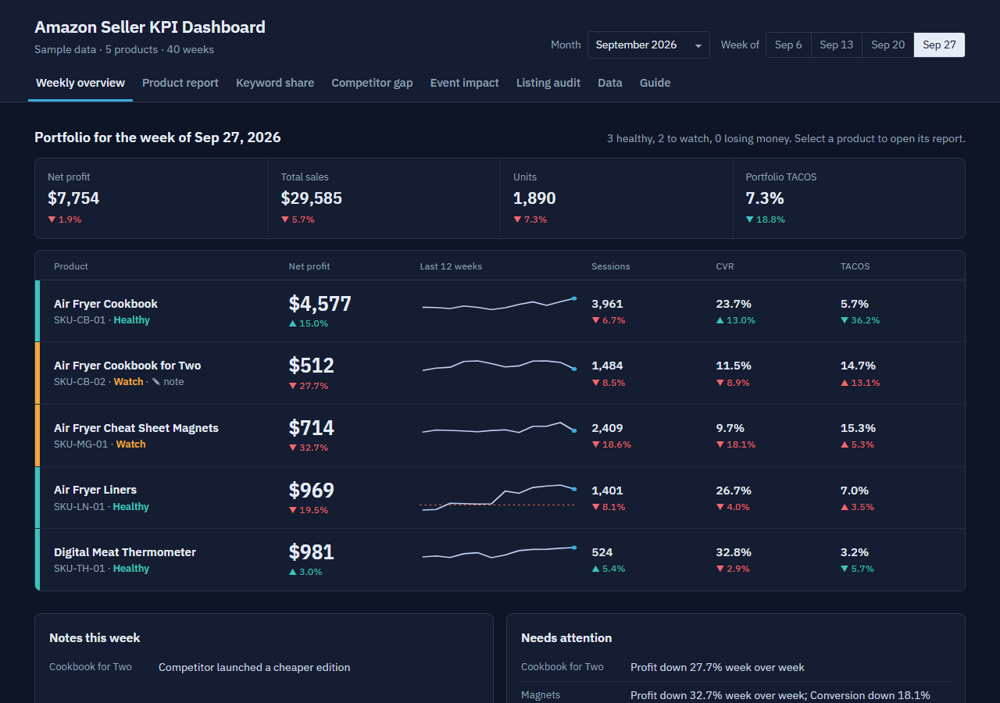

# Amazon Seller KPI Dashboard

A weekly KPI review tool for an Amazon product catalog: an air fryer cookbook, a cookbook for two, cheat sheet magnets, air fryer liners, and a meat thermometer. It turns raw weekly numbers into a status for every product, a plain-English summary of what moved and what to do next, and supporting views for keyword share, competitor gaps, event impact, and listing audits.

You can add each new week's numbers by uploading a CSV or typing them in, and leave notes on any product and week.

**Live demo:** https://ivancartago.github.io/amazon-kpi-dashboard/



> **The numbers in this repository are synthetic.** The product types are real; every figure, SKU, and event in `data/sample-data.js` was generated for demonstration. The app opens on this sample data. Anything you add is stored only in your own browser (see [Where your data lives](#where-your-data-lives)).

## What it does

| Tab | What it answers |
| --- | --- |
| **Weekly overview** | Pick a month, then a week in that month, from the picker at the top right. Shows which products are healthy, which need watching, and which are losing money this week. Portfolio totals, 12-week profit sparklines, notes, and flagged issues. |
| **Product report** | For one product: status, the biggest week-over-week moves, next steps, 21 metrics against last week and the 8-week average, charts, and a note for the week. |
| **Keyword share** | Impression share vs click share, CTR and CVR against the market, and organic rank for each product's main keywords. |
| **Competitor gap** | Trailing 30-day revenue against the top 3 listings in the category, and the revenue needed to move up a rank. |
| **Event impact** | Daily results before and after an event (here, earning a Best Seller badge), against the same days last year. |
| **Listing audit** | A 57-point listing checklist per product, with editable statuses and notes, and CSV export. |
| **Data** | Upload CSVs, download templates, enter a week by hand, back up and restore. |
| **Guide** | Every metric's definition and formula, the status rules, and the CSV columns. |

## Adding each week's numbers

### Recommended: keep a Google Sheet in the template format

1. In the app, go to **Data → Templates → Weekly numbers**. You get a CSV with your product IDs and next week's date already filled in. (Copies are also in `templates/`.)
2. Import it into a Google Sheet once. Each week, add one row per product at the bottom.
3. To upload: **File → Download → Comma-separated values (.csv)**, then drop the file on **Data → Upload a CSV**.
4. The app shows a preview (new rows, replaced rows, any problems) before anything is saved. Click **Import**. The dashboard jumps to the newest week you uploaded; use the month and week picker to look back.

You can upload just the new week or the whole sheet every time. Rows for a product and week that already exist are replaced, so re-uploading is safe.

**Why one row per product per week?** A report-style sheet, with products side by side and "Percent Change" and "Notes" rows in between, is easy to read but hard for software to process. A long, flat table (one row = one product, one week) never needs its layout changed when you add a week or a product, and the app calculates all the percentages and changes itself.

### Weekly CSV columns

| Column | Where it comes from | Required |
| --- | --- | --- |
| `week` | Any date in that week (`2026-10-04` or `10/4/2026`). Moved to the week's Sunday. | Yes |
| `product_id` | The ID shown on the Data tab (`cookbook`, `liners`, ...) | Yes |
| `product_name` | Only needed to add a new product | No |
| `sessions`, `units`, `total_sales` | Business report | Yes |
| `ppc_spend` | Ads report | Yes |
| `ppc_sales`, `ppc_clicks`, `ppc_units`, `ppc_impressions` | Ads report | Recommended |
| `amazon_fees_per_unit`, `landed_cost_per_unit` | Fee preview, purchasing | First week only; blanks reuse the last known value |
| `net_profit` | Your profit tool (e.g. Sellerboard) | No; blank is estimated as units × margin − PPC spend |
| `note` | Anything worth remembering about that week | No |

Enter raw numbers only; don't add percent columns. `$` signs and thousands separators are fine, and `(120)` is read as −120. Keyword and competitor templates work the same way; percent columns there accept `4.5%`, `4.5`, or `0.045`.

### Other ways to add data

- **Enter a week by hand** on the Data tab, or click **Edit this week's numbers** on a product report.
- **Notes**: type in the note box on a product report and click **Save note**. Notes appear on the overview and in the product's event log. Audit checkpoints have their own notes when you filter the audit to one product.

## Where your data lives

Everything you upload, type, or comment is saved in your browser's local storage on that device. It is **not** uploaded to GitHub or anywhere else, so real numbers stay private even when the dashboard is hosted on a public GitHub Pages site.

That also means:

- Other people who open the link see the sample data, not yours.
- Clearing your browser data erases it. Use **Data → Download backup** after each weekly update.
- To move to another computer or browser, use **Restore backup** there.
- **Reset to sample data** puts the demo back; **Clear all numbers** gives you an empty dashboard to fill with your own history.

If you ever commit real numbers into `data/sample-data.js`, they become public. Keep real data in a private repository, or only in the browser.

## How the numbers are calculated

The app stores only raw weekly inputs and derives everything else:

- **Conversion rate** = units ÷ sessions
- **TACOS** = PPC spend ÷ total sales
- **Unit margin before ads** = price − Amazon fees − landed cost
- **Break-even CVR** = (PPC spend ÷ sessions) ÷ unit margin. Below it, ad-driven traffic loses money.
- **Ad cost share of margin** = (PPC spend ÷ units) ÷ unit margin

**Status rules**: *Losing money* if net profit is below zero. *Watch* if profitable but profit fell more than 20%, conversion fell more than 15%, TACOS is above 20%, or conversion is below break-even. Otherwise *Healthy*. The full list is in the **Guide** tab.

## Run it locally

No install or build step. Unzip or clone, then double-click `index.html`. An internet connection is needed for the charts and font.

If your browser blocks something when opened as a file, serve the folder instead:

```bash
python -m http.server 8000
# then open http://localhost:8000
```

## Publish on GitHub Pages

1. Push the repository to GitHub.
2. **Settings → Pages → Build and deployment**: *Deploy from a branch*, `main`, `/ (root)`, **Save**.
3. The site is live at `https://<your-username>.github.io/<repo-name>/` within a couple of minutes. (This repository's copy is at https://ivancartago.github.io/amazon-kpi-dashboard/.)

## Project structure

```
index.html              page shell
assets/app.js           data layer, CSV import, metrics, status rules, views
assets/styles.css       layout and light/dark themes
data/sample-data.js     synthetic sample data
templates/*.csv         blank upload templates
docs/screenshot.png     README image
```

Built with plain HTML, CSS, and JavaScript, [Chart.js](https://www.chartjs.org/) 4.4.1, and IBM Plex Sans.

## About

Built by Ivan Cartago. The metric formulas, status rules, and review workflow come from a weekly KPI process used to manage a multi-product Amazon catalog.
